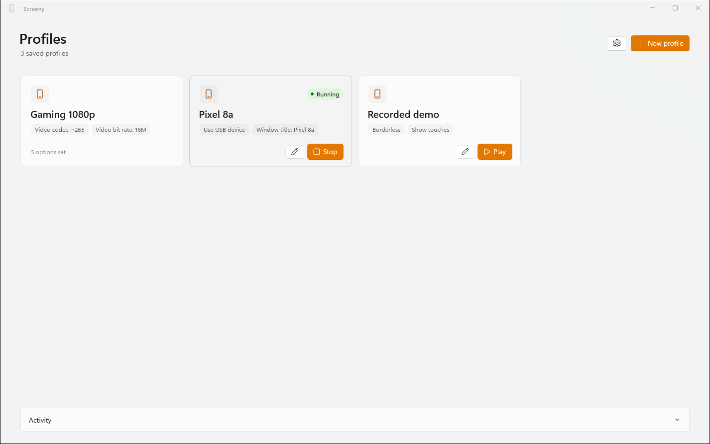
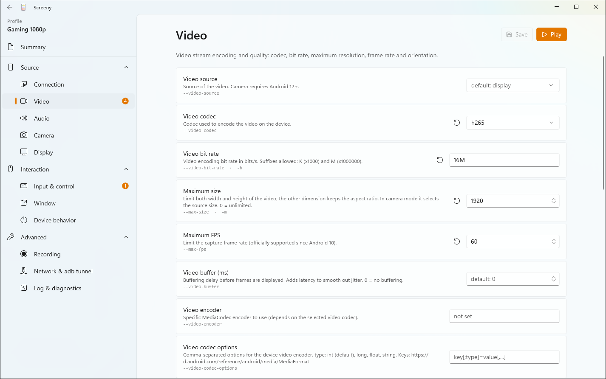

<p align="center">
	
</p>

<h1 align="center">Screeny</h1>

<p align="center">
	<b>A friendly Windows front end for <a href="https://github.com/Genymobile/scrcpy">scrcpy</a>:<br/>
	save your Android mirroring setups as profiles and launch them with one click.</b>
</p>

<p align="center">
	<a href="https://github.com/amellini/screeny/releases/latest"></a>
	
	
</p>



[scrcpy](https://github.com/Genymobile/scrcpy) is a wonderful tool to mirror and control an Android phone from your PC, but it is driven
entirely by command-line flags — almost a hundred of them. Screeny wraps it in a small native Windows app:
you pick the options from a settings page (with an explanation for each one), save the result as a **profile**,
and from then on a single click on **Play** opens your phone on screen.



## Features

- **Profiles as tiles** — every saved setup is a card; hover it to **Play** or **Edit**. Right-click for more.
- **Every scrcpy option, explained** — 98 flags grouped in a PowerToys-style settings page, each with the right
  control (toggle, number, drop-down, text…), a description and the original `--flag` name.
- **Safe defaults** — options you don't touch are not passed at all, so scrcpy uses its own defaults.
- **Checks before launch** — incompatible options (e.g. camera flags without `--video-source=camera`)
  are flagged and Play is disabled until they are fixed.
- **Live command line** — see (and copy) the exact `scrcpy …` command each profile produces.
- **Lives in the tray** — closing the window keeps Screeny in the notification area. The tray menu lists your
  4 most recently used profiles (greyed out while already running) and **Exit**.
- **Gets out of the way** — after Play the window hides itself; it comes back only if scrcpy fails, showing the error.
- **Remembers running sessions** — scrcpy keeps running when you quit Screeny; at the next start, sessions whose
  window title matches a profile are picked up again and can be stopped from the app.
- **Plain JSON files** — profiles are stored in `Documents\Screeny\Profili\<name>.json`, easy to back up or share.
- **English, Italian, Spanish and French** — follows the Windows language, or pick one in Settings.
- Light / dark / system theme, activity log, single instance.

## Requirements

- Windows 10 (1809) or later / Windows 11, x64 or ARM64.
- **scrcpy** installed on the PC (Screeny does not bundle it — see below).
- An Android device (Android 5.0+) with **USB debugging** enabled.
  Audio forwarding needs Android 11+, camera mirroring Android 12+.

## 1. Install scrcpy

Screeny launches `scrcpy.exe`, so scrcpy must be installed first. The Windows build of scrcpy already
contains `adb`, so you don't need the Android SDK.

**Option A — winget (recommended)**

```powershell
winget install --exact Genymobile.scrcpy
```

Close and reopen any open terminal (or sign out and in) so that `scrcpy` is on your `PATH`, then check it:

```powershell
scrcpy --version
```

**Option B — manual**

1. Download `scrcpy-win64-vX.Y.zip` from the [scrcpy releases](https://github.com/Genymobile/scrcpy/releases/latest).
2. Extract it anywhere, for example `C:\Tools\scrcpy`.
3. In Screeny open **⚙ Settings → scrcpy executable** and enter the full path, e.g. `C:\Tools\scrcpy\scrcpy.exe`.

Other package managers work too (`scoop install scrcpy`, `choco install scrcpy`).

## 2. Prepare your phone

1. On the phone open **Settings → About phone** and tap **Build number** seven times to unlock *Developer options*.
2. In **Settings → System → Developer options** turn on **USB debugging**.
3. Connect the phone with a USB cable and accept the *Allow USB debugging?* prompt (tick *Always allow*).

To verify, run `scrcpy` once from a terminal: if your phone appears on screen, Screeny will work too.

**Wireless:** once the phone is paired over USB you can use the *TCP/IP connection* option (`--tcpip`) in a profile,
or Android 11+ *Wireless debugging* — see the scrcpy [connection docs](https://github.com/Genymobile/scrcpy/blob/master/doc/connection.md).

## 3. Install Screeny

1. Download the latest **`Screeny-x.y.z-win-x64.zip`** (or `win-arm64` for ARM PCs) from
   [Releases](https://github.com/amellini/screeny/releases/latest).
2. Extract it into a folder of your choice and run **`Screeny.exe`**.
   It is portable and self-contained (about 90 MB, mostly the bundled .NET and Windows App SDK runtimes):
   no installer and nothing else to install.

> The executable is not code-signed, so Windows SmartScreen may show *"Windows protected your PC"* the first time:
> click **More info → Run anyway**.

## How it works

1. **New profile** creates a profile and opens the editor.
2. On the left you find the option groups (Connection, Video, Audio, Camera, Display, Input & control, Window,
   Device behavior, Recording, Network, Log). Each option shows its explanation and the scrcpy flag it maps to;
   the **↺** button resets it to scrcpy's default. The *Summary* page shows the name, the resulting command line
   and the options you set.
3. **Save** (Ctrl+S) writes the profile to `Documents\Screeny\Profili\<name>.json`:

   ```json
   {
   	"name": "Gaming 1080p",
   	"options": {
   		"max-size": "1920",
   		"video-codec": "h265",
   		"max-fps": "60"
   	}
   }
   ```

4. **Play** (on the tile, in the editor or in the tray menu) starts
   `scrcpy --max-size=1920 --video-codec=h265 --max-fps=60 --window-title=Gaming 1080p`.
   The scrcpy window title is the profile name unless you set one; Screeny uses it to recognise the session later.
5. **Stop** closes the scrcpy window gracefully, so scrcpy restores the phone state (screen timeout, show touches…).
   scrcpy's output and exit code end up in the *Activity* log.

If Screeny itself ever crashes, the details are written to `Documents\Screeny\crash.log` — please attach it to an issue.

Under the hood the editor is generated from [`docs/scrcpy-options.json`](docs/scrcpy-options.json), a catalog of
every option with its type, allowed values, ranges, defaults, dependencies and incompatibilities, extracted from
scrcpy's own command-line parser (`app/src/cli.c`, v5.0.1). [`docs/check_catalog.py`](docs/check_catalog.py)
verifies the catalog against a newer `cli.c` when scrcpy is updated.

## Translations

The interface strings live in [`Screeny/Strings/<lang>.json`](Screeny/Strings) and the option texts in
[`docs/i18n/scrcpy-options.<lang>.json`](docs/i18n) (the catalog itself is written in Italian; each file overrides it).
To add a language, copy the English files, translate the values, add the language to `Loc.Languages` and run:

```powershell
python docs/check_i18n.py
```

It reports missing or extra keys and mismatched `{0}` placeholders.

## Build from source

Requirements: Windows 10/11, the .NET 10 SDK and the Windows App SDK tooling
(Visual Studio with the *WinUI application development* workload).

```powershell
git clone https://github.com/amellini/screeny.git
cd screeny/Screeny
dotnet build -p:Platform=x64
```

Open `Screeny/Screeny.slnx` in Visual Studio to run and debug it (packaged MSIX profile).
To produce the same portable build as the releases:

```powershell
dotnet publish Screeny.csproj -c Release -p:Platform=x64 -r win-x64 -p:WindowsPackageType=None -p:WindowsAppSDKSelfContained=true -p:SelfContained=true -o publish
```

Every push to `main` runs [`.github/workflows/release.yml`](.github/workflows/release.yml), which publishes the x64
and ARM64 zips as a new GitHub release (`VersionPrefix` from the project + build number).

## Credits

- [scrcpy](https://github.com/Genymobile/scrcpy) by Genymobile (Apache-2.0) does all the real work — Screeny is just a launcher for it.
- UI built with [WinUI 3](https://learn.microsoft.com/windows/apps/winui/winui3/) and the
  [Windows Community Toolkit](https://github.com/CommunityToolkit/Windows) settings controls.
- App icon from [Flaticon](https://www.flaticon.com/).

## License

[MIT](LICENSE) © Andrea Mellini
